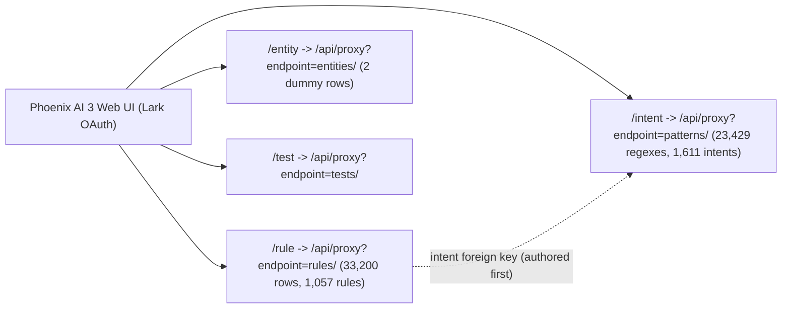

# 01 — Phoenix AI 3 & `phoenix-st-v2` Database Architecture & Live Conventions

Comprehensive technical reference synthesized from [Find Call Monitoring Table](t3-thread://v2/4780035e-4952-4145-9e89-ec6f81c67326/a7b1f9c6-aba6-4b7c-ab9b-10207bb91a35) and this forked session, covering the `phoenix-st-v2` repository, the live Phoenix AI 3 platform (`http://172.20.0.39:8088`), and its full rule and regex catalogs.

---

## 1. Where the 14-Column Rule Table Lives

### Local `phoenix-st-v2` (`staging-branch` vs. Feature Branches)
- **`staging-branch` (running local Docker DBs):** Neither `call_qa` (`phoenix-call-qa-local-db`, port `3308->3306`) nor `llm_disposition` (`qwago-llm-disposition-db`, port `3307->3306`) contains the 14-column table yet; `call_qa` only has legacy `rule`, `rule_client_status`, `prompt`, and `coaching_metric_catalog`.
- **Feature branches (`origin/feat/qa-intent-llm-only`, `origin/feature/qa-pipeline-mysql-rules`, `origin/feat/devj`, `origin/staging-temp`, `origin/main-temp`):**
  - **MySQL table:** `call_qa.qa_checklist_row` (defined in `backend/migrations/create_qa_rule_catalog.sql` and `docker/call-qa-full/init/002_qa_rule_catalog.sql`).
  - **Frontend NLU UI:** `frontend/src/components/nlu/rule-module-screen.tsx` (displays all 14 headers + `Entity` + `Intent Description`, supports CSV import/export).
  - **Backend services:** `backend/app/domain/qa_rules/catalog_service.py` and `backend/app/schemas/qa_rule_catalog.py`.

### Exact 14-Column CSV / DB Schema

| # | CSV Column Header | DB Column (`qa_checklist_row`) | MySQL Type | Live Production Distribution (33,200 rows) |
| :-: | --- | --- | --- | --- |
| 1 | `Rule Name` | `rule_name` | `varchar(255)` | 1,057 unique rules (one rule name per campaign + disposition) |
| 2 | `Placement Name` | `placement_name` | `varchar(255)` | `default_placement` on **33,200 / 33,200** rows (**100%**) |
| 3 | `Passing Score` | `passing_score` | `decimal(10,4)` | `80` (24,905), `85` (2,839), `150` (1,860), `90` (1,667), `95` (1,533), `null` (305), `100` (91) |
| 4 | `Speaker` | `speaker` | `varchar(64)` | `agent` (**29,985**), `client` (**3,215**) |
| 5 | `Component` | `component` | `varchar(255)` | Section/pillar name (or flattened criterion name in newer BPI `_SL_` rules) |
| 6 | `Component Score` | `component_score` | `decimal(10,4)` | Awarded **once per unique `(Rule Name, Component, Checklist Name)`**, not per intent row |
| 7 | `Component Condition ID` | `component_condition_id` | `varchar(64)` | `1` (**31,889** rows = AND group); `2..15` (**1,311** rows = OR-alternative groups, mostly PID) |
| 8 | `Checklist Name` | `checklist_name` | `varchar(255)` | Criterion/checkpoint label; must match case-sensitively across sibling intent rows |
| 9 | `Intent` | `intent` | `varchar(255)` | Semantic `snake_case` key referencing `/intent` regex catalog |
| 10 | `Special Condition` | `special_condition` | `varchar(512)` | Gating, auto-fail/pass, negation, priorities, acoustic thresholds, risk tiers |
| 11 | `Passing Component Remarks` | `passing_component_remarks` | `text` | Past-tense confirmation when component passes (or `"High/Medium/Low Risk"` on `Risk Level`) |
| 12 | `Failing Component Remarks` | `failing_component_remarks` | `text` | Negative mirror of passing remark (empty on `Risk Level`) |
| 13 | `Failing Intent Remarks` | `failing_intent_remarks` | `text` | Newest convention: `"The collection specialist failed to ..."` |
| 14 | `Fail Recommendation` | `fail_recommendation` | `text` | Newest convention: `"Ensure the collection specialist ..."` |

*(Extra DB-only columns: `id`, `sqlite_id`, and `entity` — `entity` is `null` on **33,198 / 33,200** rows and effectively unused.)*

---

## 2. Live Phoenix AI 3 Platform Architecture (`http://172.20.0.39:8088`)

### Key Mechanics Discovered in `/intent` (`patterns/`)
1. **Taglish/English Regex Engine:** Intents are backed by Taglish/English regexes (`intent`, `speaker`, `regex`, `id`).
2. **Rules Are Authored Before Patterns:** In the newest batch of rules (`id >= 80,000`, 201 rules / 6,435 rows), **3,893** intent references exist in `patterns/` and **2,542** do not yet have regexes — proving rule CSVs are authored first with clean semantic `*_intent` names, and regexes are added afterward.
3. **Why `Speaker = client` Exists (3,215 rows):**
   - **`Risk Level` (2,806 / 2,887 rows = 97.2% `client`):** Classifies borrower-spoken risk cues:
     - `high_risk_intent` (97 regexes, `r1`): medical/financial distress (`"hospitalize"`, `"nahospital"`, `"may sak[ie]t"`, `"walang ipon"`).
     - `medium_risk_intent` (19 regexes, `r2`): willing to pay on payday (`"pero babayaran"`, `"willing to settle"`, `"sa payday/sahuran"`).
     - `low_risk_intent` (16 regexes, `r3`): immediate full settlement (`"pasok na payment"`, `"mag full payment ako"`, `"lump sum na lang"`).
   - **`active_listening_intent` (264 rows + campaign variants, `client`, `negate`):** Matches borrower frustration/interruption cues (`"paulit-ulit ka naman"`, `"sinabi ko na"`, `"hindi ka ba nakikinig"`).
4. **How `negate` / `auto_fail,negate` Works:** Even when an intent is named neutrally (e.g., `professionalism_intent`, 112 regexes: `\bputa\b`, `gago`), the regex matches the **violation utterance**, and `negate` causes a match to **fail** the row.

---

## 3. Verified Conventions in the Newest Non-Legacy Rules (`id >= 80,000`)

Sorting all 1,057 rules by `max(id)` surfaces the newest production rules (`id = 85,000–86,472`: `EWB_*`, `BANKARD_*`, `BPI_RBANK_*_SL_*`, `BPI_PL_*_SL_*`):

1. **`RPC` = Right Party Contact (Verified Globally):**
   - `RIGHT_PARTY_CONTACT`: **64 rules**; `THIRD_PARTY`: **71 rules**; `"Right Party"` in text/remarks: **209 rows**.
   - `RIGHT_PERSON_CONTACT`: **0 rules**; `THIRD_PERSON`: **0 rules**; `"Right Person"` in text/remarks: **0 rows** (`PERSON` only appears in `PERSONAL_LOAN`).
   - Both the RCBC Bankard PDF and Security Bank ACA PDF explicitly print **"Right Party Contact"**.
2. **`Risk Level` Standard 3-Row Block:**
   - `Passing Score = 80`, `Speaker = client`, `Component = Risk Level`, `Component Score = ""`, `Component Condition ID = 1`.
   - `High Risk` (`high_risk_intent`, `r1`, `Passing Component Remarks = "High Risk"`), `Medium Risk` (`medium_risk_intent`, `r2`, `"Medium Risk"`), `Low Risk` (`low_risk_intent`, `r3`, `"Low Risk"`), with failing remarks & recommendation empty.
3. **Standard Remarks Voice:**
   - Uses **"The collection specialist"** (**3,214 rows** in `id >= 80,000` vs. 794 `"The agent"`):
     - `Failing Intent Remarks`: `"The collection specialist failed to ..."`
     - `Fail Recommendation`: `"Ensure the collection specialist ..."`
4. **Active `Special Condition` Vocabulary (Global Counts):**
   - `""` (12,215) — standard positive audio check
   - `auto_fail` (5,130) — mandatory PID, Call Recording Disclosure, ZTP/Critical gates
   - `auto_pass` (3,981) — non-audio CRM/documentation/SLA/escalation checks
   - `not_applicable` (3,525) — disposition-gated checks
   - `auto_fail,negate` / `negate,auto_fail` (1,303) — prohibited behaviors (profanity, harassment, unfair debt collection, misrepresentation)
   - `r1` / `r2` / `r3` (984–985 each) — `Risk Level` tiers
   - `voice intent must be less than 0.55` (662) / `0.20` (99) — pause ratio / call pace / hold time
   - `voice intent must be between -10 and -5` (672 incl. whitespace variants) / `-20 and -5` (88) — loudness
   - `negate` (530) — non-ZTP negative checks (`active_listening_intent`, jargon)
   - `priority1`–`priority5` (444 / 467 / 257 / 194 / 55) — tiered negotiation hierarchy
   - `2_sentences_required` (311) & `auto_fail,2_sentences_required` (161) — requires 2 utterances

---

## 4. Domain Abbreviation & Phrase Reference
The complete 40+ entry domain glossary decoded directly from live rules and regexes is persisted in the repository at [nlu_conventions_glossary.md](file:///C:/Users/SPM/Documents/NLU-guideline-transcoder/docs/nlu_conventions_glossary.md). Key high-signal decodings:
- **`VS`** = **Voluntary Surrender** *(regex: `(masurrender|surrender).*(sasakyan|car|kotse|auto|motor|unit)`)*
- **`EPA`** = **Extended Payment Arrangement** *(regex also matches `"estimated partial amount"`)*
- **`SPA`** = **Special Payment Arrangement** *(amnesty/waiver in negotiation; **Special Power of Attorney** in ID verification)*
- **`MRI`** = **Mortgage Redemption Insurance** *(regex: `death.*certificate`, `MRI`)*
- **`OB` / `TOB` / `MAD` / `OTP` / `PIF` / `DP` / `MOP`** = Outstanding Balance / Total Outstanding Balance / Minimum Amount Due / One-Time Payment / Pay in Full / Down Payment / Mode of Payment
- **`PID` / `RFD` / `RBP` / `SOI` / `SOF` / `BTC` / `ETA` / `RTP` / `BP`** = Positive Identification / Reason for Delinquency / Reason for Broken Promise / Source of Income / Source of Funds / Best Time to Call / Availability / Refusal to Pay / Broken Promise
- **`CH` / `CM` / `IC4` / `PWO` / `WOFF` / `SL` / `SPM` / `LUZ` / `SALAD` / `BNPL`** = Cardholder / Cardmember (or Collection Module in MBTC) / RCBC IC4 Memo System / Pre-Write-Off / Write-Off / Soft-Call or Late-Stage tag / S.P. Madrid & Associates / Luzon / Salary Advance / Buy Now Pay Later
