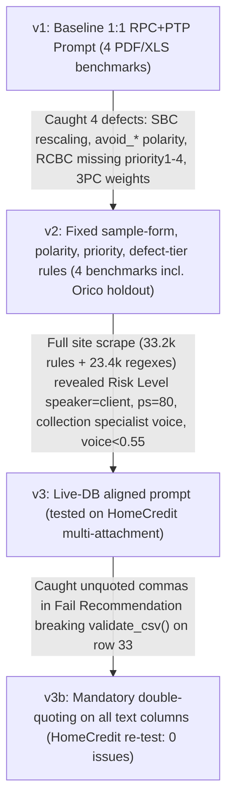

# 03 — Prompt Reverse-Engineering, Self-Inference & Benchmark Evaluation Log

Records how [prompt.txt](file:///C:/Users/SPM/Documents/NLU-guideline-transcoder/prompt.txt) was reverse-engineered from live Phoenix AI 3 rules and iteratively validated on **Gemini 4 Hydrogen (`high` reasoning effort)** across 6 distinct attachment types.

---

## 1. Transcoder Pipeline & Self-Inference Methodology

- **Application wiring ([llm.py](file:///C:/Users/SPM/Documents/NLU-guideline-transcoder/llm.py)):**
  - Sends `SYSTEM_INSTRUCTION` (`"Reply with the CSV only: a header row, then one record per line. No commentary, no code fences."`) + [prompt.txt](file:///C:/Users/SPM/Documents/NLU-guideline-transcoder/prompt.txt) (substituting `{sub_campaign}` and `{date}`) + attachments.
  - Validates every response via `clean_csv()` + `validate_csv()` (strict RFC-4180 CSV, non-empty header + data rows, exact column-count parity on every row).
  - *(Recent repo evolution: commits `50be3f7` and `a8454ce` transitioned [llm.py](file:///C:/Users/SPM/Documents/NLU-guideline-transcoder/llm.py) from Gemini AI Free Tier to NanoGPT `google/gemini-4-hydrogen` with `reasoning_effort="high"` and added Office text/image extraction for `.docx`/`.xlsx`/`.pptx`/`.odt`/`.ods`/`.odp`.)*
- **Self-Inference Setup:**
  - Verified that Gemini 4 Hydrogen's API default thinking/reasoning level is **`high`**.
  - Local `agy` CLI (`C:\Users\SPM\AppData\Local\agy\bin\agy.exe`) is installed but not signed in (`Error: Please sign in to view available models`).
  - Used isolated, zero-history `delegate_task` child runs pinned to `providerInstanceId: "antigravity"`, `model: "gemini-4-hydrogen"`, `options: { thought_level: "high" }`. Each child saw **only** `prompt.txt`, `SYSTEM_INSTRUCTION`, and the target attachment file(s) — zero parent conversation leakage.
  - Automated scoring script: [eval_csv.py](file:///C:/Users/SPM/.t3/userdata/providers/antigravity/ac0a3dfd6dddb20962cecff6ee5fe65e19d3923be20e52c5ab52ff877f7e4c32/antigravity-acp/brain/343766d0-306d-4f9c-80a9-4f2305b76777/scratch/eval_csv.py) checks `llm.clean_csv()`, `llm.validate_csv()`, exact 14-column headers, rule names, `default_placement`, `speaker`, `*_intent` syntax, `negate` polarity hygiene, `Risk Level` (`r1`–`r3`), casing drift, score sums, `RPC` vs. `PTP` structural parity, and remarks completeness.

---

## 2. Prompt Evolution Log (`v1` → `v2` → `v3` → `v3b`)

### Exact Defects Caught & Fixed Per Iteration
1. **`v1` → `v2` (from auditing `TALA EDC`, `RCBC Cards PWO`, `SBC Auto Loan Curing`, `BPI Rbank PL`):**
   - **Filled-in sample form rescaling (`SBC`):** Sample PDF had `Did Not Meet = 0.00` and `Exceeds Expectations` bonuses; model rescaled all weights (`5 -> 5.68`, `18 -> 20.45`). **Fix:** Explicitly ignore single-call earned/deducted scores and extract the blank rubric template without rescaling when gating `not_applicable`.
   - **Negated-intent polarity inversion (`RCBC`, `BPI`, `SBC`):** Model emitted `avoid_jargon_intent` with `Special Condition = negate`. **Fix:** Require negative/violation intent names (`use_of_jargon_intent`) whenever `negate` / `auto_fail,negate` is set.
   - **Missed payment-option hierarchy (`RCBC`):** `"Offered appropriate payment options"` stayed 1 row. **Fix:** Expand both negotiation-hierarchy and payment-options checklists into `priority1`–`priority4`.
   - **3PC weight leakage (`SBC`):** `not_applicable` 3PC rows retained `14`/`30`/`12` scores (`all_score_sum = 163.95`). **Fix:** Force empty `Component Score` on `not_applicable` 3PC rows; add proportional defect-tier weighting for Critical/Important/Essential forms.
2. **`v2` → `v3` (from scraping all 33,200 live rules + 23,429 `/intent` regexes):**
   - **`Risk Level` block:** Changed `Speaker` from `agent` → **`client`**, `Passing Score` from `""` → **`80`**, and `Passing Component Remarks` from `""` → **`High Risk` / `Medium Risk` / `Low Risk`**.
   - **Remarks voice:** Standardized on `"The collection specialist..."` / `"Ensure the collection specialist..."`.
   - **Acoustic & canonical intents:** Added `voice intent must be less than 0.55` for call-pace/hold-time checks and seeded the prompt with the newest canonical intent vocabulary (`id >= 80,000`).
3. **`v3` → `v3b` (from testing `HomeCredit Fintech` multi-attachment row):**
   - **Unquoted commas in prose remarks (fatal for `llm.validate_csv()`):** Rows 33–34 had unquoted commas (`steady, understandable`, `plain, easy-to-understand`), producing 15 columns instead of 14.
   - **Fix:** Mandated double-quoting (`"..."`) on `Component`, `Checklist Name`, `Special Condition` (when non-empty), and all 4 remarks/recommendation columns. Re-test passed with **0 issues**.

---

## 3. Consolidated Quantitative Benchmark Results

| Benchmark & Input Format | Prompt Ver. | Rows / Disp | `validate_csv` & `eval_csv` | Core Score Sum (`_PTP`) | Key Fidelity Highlights |
| --- | :---: | :---: | :---: | :---: | --- |
| **TALA EDC** (4-page QAFE PDF + ZTPs) | v1 | 47 | ✅ `ok: true` | `99.96` | All 7 pillars, 21 checkpoints, 8 ZTPs (`auto_fail` / `auto_fail,negate`), `Risk Level` |
| **RCBC Cards PWO** (Unweighted Yes/No PDF + 3PC) | v2 | 41 | ✅ `ok: true` | `99.94` | Even `5.26` weights, `priority1`–`priority4`, `use_of_jargon_intent [negate]`, 3PC empty score, `IC4 Memos = auto_pass` |
| **SBC Auto Loan Curing** (Filled-in ACA sample PDF) | v2 | 42 | ✅ exact PDF weights | `100.0` total (`98.0` active) | Exact PDF weights preserved (`5,1,1,6,4,2,3,3,10,8,18,5,3,2,2,5,2,15` — zero rescaling); 2-pt `No PTP expectations` gated on `_PTP`; 18-pt `Secure PTP` gated on `_RPC` |
| **BPI Rbank PL** (3-pillar fractional XLS) | v2 | 56 | ✅ `ok: true` | `100.02` | Exact 40%/30%/30% weights (`6.67`, `4.44`, `3.75`, `2.5`, `1.88`), 9 CRM/SLA `auto_pass`, `active_listening_intent` (`client`, `negate`), `priority1`–`priority4` |
| **Orico Auto Loan** *(holdout: defect-tier Excel)* | v2 | 43 | ✅ `ok: true` | `100.05` | All 22 criteria proportionally weighted (`Critical=5.75`, `Important=3.45`, `Essential=2.30`), `priority1`–`priority4`, 0 polarity inversions |
| **HomeCredit Fintech** *(multi-attachment: Excel + 2 PNG slides)* | v3b | 48 | ✅ `ok: true` (0 issues) | `100.0` (`90.0` active on `_RPC`) | Synthesizes all 13 `Q1`–`Q13` weights (`100.0`) + both slide decks + CTQ/Non-Critical flags; `Risk Level` (`client`, `80`, `r1`–`r3`); 8 PTP rows cleanly gated; all text columns quoted ([v3b_homecredit_fintech.csv](file:///C:/Users/SPM/.t3/userdata/providers/antigravity/ac0a3dfd6dddb20962cecff6ee5fe65e19d3923be20e52c5ab52ff877f7e4c32/antigravity-acp/brain/343766d0-306d-4f9c-80a9-4f2305b76777/scratch/v3b_homecredit_fintech.csv)) |

- **Repository unit tests (`pytest -q`):** **135 passed, 0 failed** (verified prior to the subsequent `nanoGPT` + Office extraction commits).
