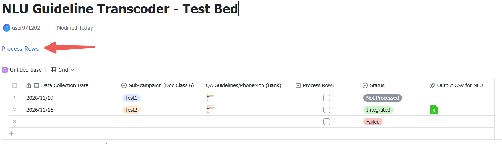

# NLU Guideline Transcoder \- Documentation

# Purpose

This file will serve as the officially maintained developer documentation for building NLU Guideline Transcoder\.

NLU Guideline Transcoder, or NLU\-GT, serves to automate the workflow of:

1. Downloading client guidelines \(PDF, XLSX, etc\.\)

2. LLM inference with custom prompt

3. Manual integration of CSV output into NLU

into a seamless select\+one\-click workflow\.

# Stack

### Frontend

Lark, HTML

The main interface component is a link embedded into the lark document itself that, when clicked, activates the service\. The link redirects the user into another page that confirms the user's selection and the statuses of jobs initiated with a simple HTML interface\.

### Backend 

**Python**

When the link on the document is clicked, the backend fires and fetches all the rows within the Lark Grid\. The column "For Processing?" determines which rows are to be ingested into the LLM for processing\. The LLM outputs a CSV file as per the prompt, then serves it to NLU as campaign rules\.

**Gemini**

Gemini was the only provider that offered a free tier API with frontier models such as the recently\-released Gemini 4 Hydrogen \- a cost effective multi\-modal LLM that can natively process PDF inputs without further processing through OCR and document parsing\. This model is on par with Claude Sonnet 5\.5 in terms of their benchmark performance, but Hydrogen has the edge in terms of native PDF processing that Sonnet does not have\.

However, free\-tier API calls are severely limited in terms of availability and latency as the provider, understandably, does not prioritize this tier\. Unless paid credits are provided, this will most likely be the case for the lifespan of this project\.

**Lark Custom App**

Creating a Lark Custom App provides the service with the necessary keys and tokens to interface with Lark's API services\.`bitable:app` provides read and write permissions on Lark Base components such as Grid, the one this service is aimed at integrating\.

### Hosting 

**Vercel**

To ensure availability of the service remains overnight, the service is hosted on Vercel, a serverless provider\. An external provider for internal SPM use is deemed appropriate at this time within the prototyping phase\.

Availability and uptime ultimately hinges on the latency of Gemini API calls.
